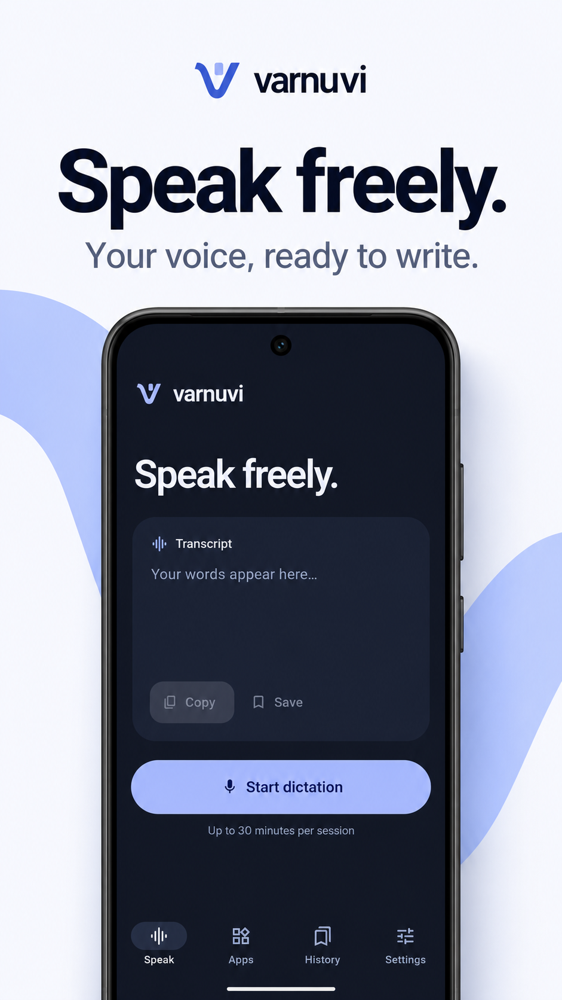
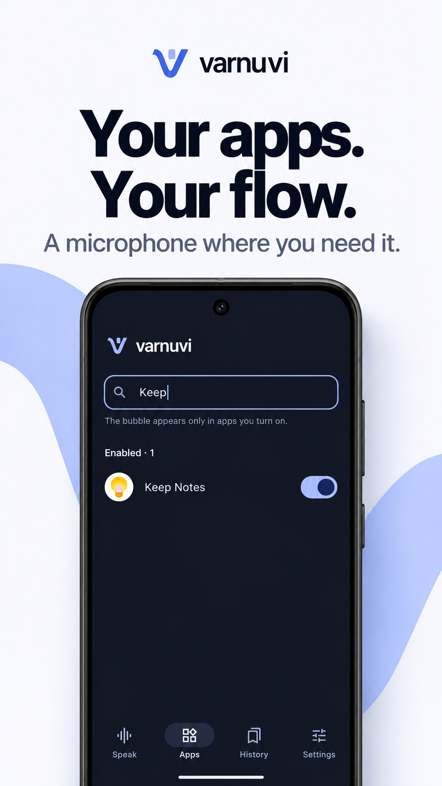
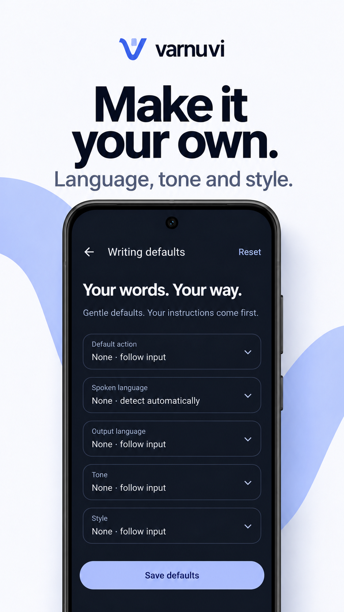
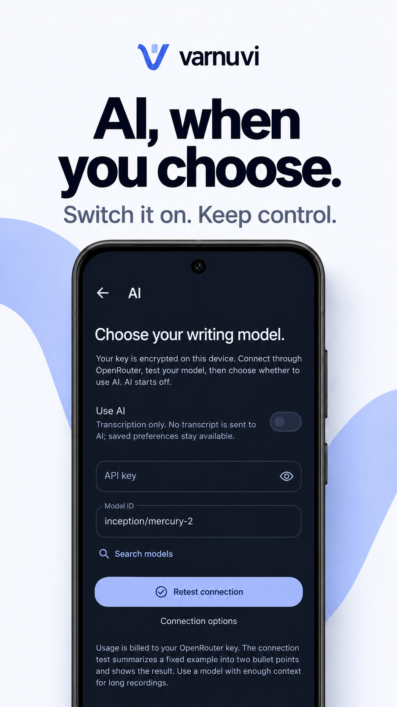
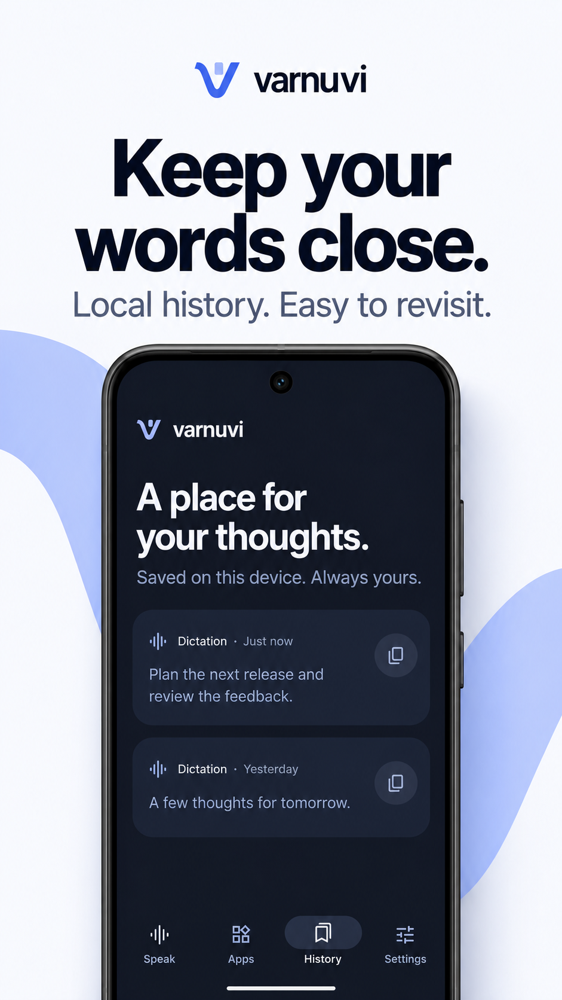
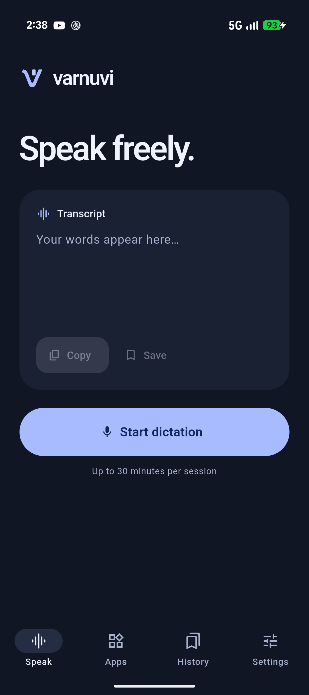
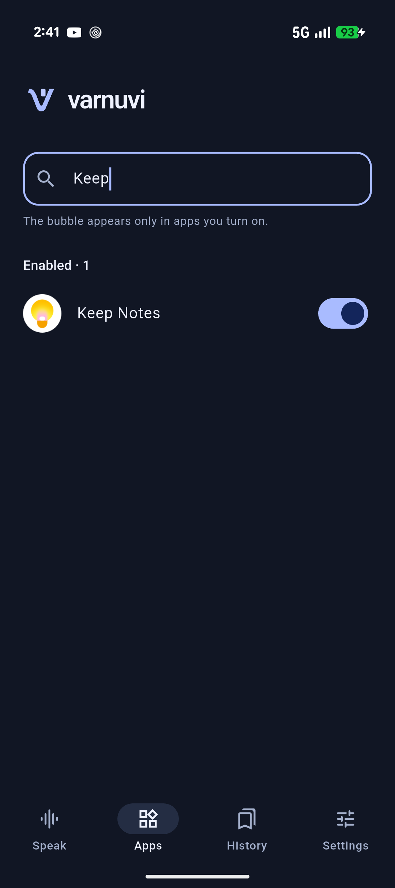
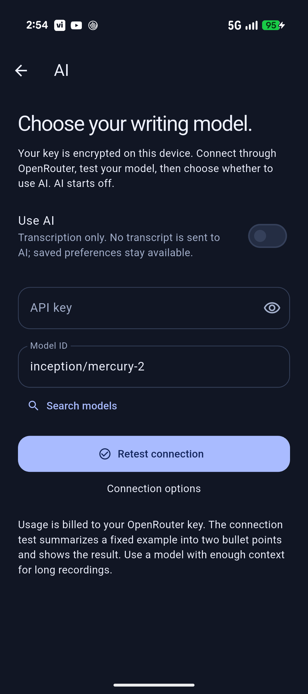

<p align="center">
  
</p>

<h1 align="center">Varnuvi</h1>
<p align="center">A little space for your voice.</p>
<p align="center">Android dictation · your apps · your writing preferences</p>

Varnuvi turns speech into editable text, inside the app or in the apps you choose.
Speak continuously, let transcription catch up in the background, then submit.
Optional writing defaults translate, summarize, or reshape the result using your
own OpenRouter key and model.

**Private development preview · Android 13+ · MIT licensed.** The repository is
being prepared for a future open-source release. The current transcription
integration is private development infrastructure. This is not a public release
or an offline speech recognizer.

## Download Android

**[Download Varnuvi 0.1.0 for Android · ARM64 APK](https://github.com/shahdivax/varnuvi/releases/download/v0.1.0/varnuvi-0.1.0-arm64-v8a.apk)**

Recommended for Pixel and most modern Android phones. Android 13+ required.
This is the first officially signed **private preview**, build **2**. Sign in
with a GitHub account that has access to this private repository to download.

[Release notes and all files](https://github.com/shahdivax/varnuvi/releases/tag/v0.1.0)
· [SHA-256 checksums](https://github.com/shahdivax/varnuvi/releases/download/v0.1.0/SHA256SUMS)

<details>
<summary>Other Android builds</summary>

- [32-bit ARM APK](https://github.com/shahdivax/varnuvi/releases/download/v0.1.0/varnuvi-0.1.0-armeabi-v7a.apk)
- [x86-64 APK](https://github.com/shahdivax/varnuvi/releases/download/v0.1.0/varnuvi-0.1.0-x86_64.apk) for compatible emulators/devices
- [Android App Bundle](https://github.com/shahdivax/varnuvi/releases/download/v0.1.0/varnuvi-0.1.0.aab) for distribution tooling; install an APK on a phone
- [Signing certificate details](https://github.com/shahdivax/varnuvi/releases/download/v0.1.0/SIGNING-CERTIFICATE.txt)

</details>

The release uses a dedicated Varnuvi certificate. Android cannot upgrade an
older development-certificate install with this APK. Preserve any local text
and your original API key before switching installations; the existing phone
installation has not been replaced. APKs, the bundle, and signing secrets are
excluded from Git; binary downloads live in the private release.

## In the app

<p align="center">
  <a href="docs/showcase/01-speak.png"></a>&nbsp;&nbsp;
  <a href="docs/showcase/02-apps.png"></a>&nbsp;&nbsp;
  <a href="docs/showcase/03-writing.png"></a>&nbsp;&nbsp;
  <a href="docs/showcase/04-ai.png"></a>&nbsp;&nbsp;
  <a href="docs/showcase/05-history.png"></a>
</p>
<p align="center"><sub>Speak · Apps · Writing defaults · AI · History. Tap a panel for full size.</sub></p>
<p align="center"><sub>AI-created showcase based on implemented screens; example history text is synthetic. Unmodified app captures are below.</sub></p>

<details>
<summary><strong>View real app screenshots</strong></summary>

<p>Unmodified captures from the Android release preview. Tap an image for full size.</p>
<p align="center">
  <a href="docs/screenshots/speak-dark.png"></a>
  <a href="docs/screenshots/apps-dark.png"></a>
  <a href="docs/screenshots/ai-dark.png"></a>
</p>
<p align="center"><sub>Speak · Apps (filtered) · Connected AI settings</sub></p>

</details>

## What you can do

- **Dictate continuously.** Exact 30-second audio chunks transcribe while you
  speak; each session is limited to 30 minutes for now.
- **Write in other apps.** Enable apps individually. A compact microphone follows
  Android's accessibility shortcut where its position is available. Select a
  text field, dictate, and return to the original cursor.
- **Keep your preferred voice.** Save an action, spoken/output languages, tone,
  and style. Every output preference starts at None/follow input. Explicit
  writing instructions take priority over these soft defaults.
- **Choose your model.** Search OpenRouter's live text-model catalog, save a key
  securely, and test the selected model. Turn **Use AI** on when you want
  processing; turn it off for transcription without model charges.
- **Edit, copy, and revisit.** In-app results stay editable; save them when you
  want. Bubble results save automatically. Local history keeps the latest 100.
- **Use a quiet interface.** Light, dark, and system appearance, real recording
  levels, and enabled apps grouped at the top of Apps.

## Get started

This checkout targets Android only. Use Flutter **3.47.7** with Dart **3.13.5**,
JDK **21**, Android SDK, and an Android **13 / API 33** or newer device. Keep the
checked-in Gradle, AGP, and Kotlin versions together.

```sh
flutter doctor
flutter config --jdk-dir=/path/to/jdk-21
flutter pub get
flutter devices
flutter run -d <device-id>
```

For dictation inside Varnuvi, grant microphone permission and tap Speak.
Transcription needs connectivity to the configured development server.

To dictate in other apps:

1. Open **Settings → Dictate in other apps**. Grant microphone permission and
   enable Varnuvi in Android's accessibility settings. Some sideloaded installs
   need Android's **Allow restricted settings** first.
2. Open **Apps** and turn on the apps you want. Everything starts disabled;
   enabled apps appear first.
3. Open one of those apps. The microphone appears without needing field focus.
   Select an editable, non-password field, then tap the microphone.
4. Submit when finished. If the original field changed or insertion is blocked,
   recover the transcript from **History**.

The Android accessibility shortcut opens Varnuvi directly. The microphone hides
outside enabled apps, while recording, and on the lock screen. If the service is
disconnected, check the live status in Settings.

### Optional writing defaults

In **Settings → AI**, enter your own OpenRouter API key, search for a model (or
enter its ID), and use **Save & test connection**. The test asks the model to
summarize a fixed example into two bullet points and displays its actual output.
It may use credits. After a successful test, **Use AI** becomes available; it
starts off. Connected settings show **Retest connection** and put key removal in
**Connection options**. Changing the saved key/model disables AI until you test
again.

Preferences are captured when recording starts. Spoken language goes to the
transcription server. Output preferences apply once to the assembled transcript,
so a summary sees the whole session. With **Use AI on**, None means no preset:
say “summarize this in bullet points” at the beginning to request a summary.
Without instructions or defaults, AI is asked to keep the wording. With **Use AI
off**, no transcript is sent to OpenRouter, even if preferences are saved. Spoken
language and transcription still work. If model processing fails, retry it or
explicitly keep the original transcript. Choose a model with enough context and
credits for long sessions; output length is bounded.

## Privacy at a glance

| Data | Where it goes |
| --- | --- |
| Microphone audio | Sent in WAV chunks to the configured transcription server. The current private integration uses **unencrypted HTTP**. |
| Completed transcript | Sent to OpenRouter and its selected provider only when **Use AI** is on for that recording. |
| History, enabled apps, preferences | Stored on your device in app-private storage; Android backup is disabled. |
| OpenRouter key | Encrypted using Android Keystore; not returned to Flutter or sent to the transcription server. |
| Focused field content | Read locally to insert safely at the cursor; not sent with the dictation. |

There are no analytics, ads, accounts, or cloud history sync. Audio is removed
locally after normal session cleanup; interrupted-process limitations and server
retention are explained in [Privacy](PRIVACY.md). The current HTTP integration
is unsuitable for sensitive recordings.

## Develop and verify

```sh
flutter analyze
flutter test
flutter build apk --debug
python3 scripts/check_chunking.py
bash scripts/check_secrets.sh
```

The native check uses the Kotlin compiler cached by an Android build and the
JDK selected by `JAVA_HOME`. It exercises the complete 30-minute sample cap
without recording or making network requests. Automated checks do not need an
OpenRouter key or a live transcription server.

Checks run locally; CI is intentionally disabled for now. An inactive
[GitHub Actions example](docs/templates/github-actions.yml.example) is retained
for optional future setup. See [Development](docs/DEVELOPMENT.md) and
[Contributing](CONTRIBUTING.md).

## Build a release

```sh
flutter build apk --release --split-per-abi
# For a future store upload:
flutter build appbundle --release
```

Release builds shrink native code/resources and tree-shake Flutter icons. Prefer
an ABI-specific APK to the universal APK for direct distribution. Without
`android/key.properties`, release outputs are **unsigned**; debug builds remain
available for local installation. Follow [Release preparation](docs/RELEASING.md)
to sign and verify a distribution build. Never distribute the debug key.

## Current boundaries

- Recording requires the visible recording screen. Screen-off/background
  microphone capture is not implemented.
- App/OEM accessibility support varies. Protected and custom canvas fields may
  not expose safe insertion. History provides recovery when a save succeeds.
- Active sessions are not restored after Android kills the process.
- The transcription server is currently fixed in native configuration. Public
  endpoint configuration and removal of private infrastructure references are
  deferred until publication preparation.
- The toolchain emits future-support warnings; coordinated upgrades need a
  separate compatibility pass. This preview has not completed release soak
  testing across OEMs, languages, network failures, and battery conditions.

## Project guide

| Document | Purpose |
| --- | --- |
| [Architecture](docs/ARCHITECTURE.md) | Capture, chunking, writing, insertion, and persistence boundaries |
| [Performance](docs/PERFORMANCE.md) | Resource budgets, build measurements, and profiling procedure |
| [Development](docs/DEVELOPMENT.md) | Toolchain, tests, troubleshooting, and device checks |
| [Release preparation](docs/RELEASING.md) | Signing, verification, and future public-repository preparation |
| [Privacy](PRIVACY.md) · [Security](SECURITY.md) | Data handling, limitations, and private vulnerability reporting |
| [Contributing](CONTRIBUTING.md) · [Changelog](CHANGELOG.md) | Collaboration and notable changes |

The app is pronounced **var-NOO-vee**. Brand source assets and transparent,
rounded-square, and circular variants live in [assets/brand](assets/brand).
The internal application ID remains `dev.voiceagent.app` to preserve existing
installs and permissions. Source is available under the [MIT license](LICENSE).
