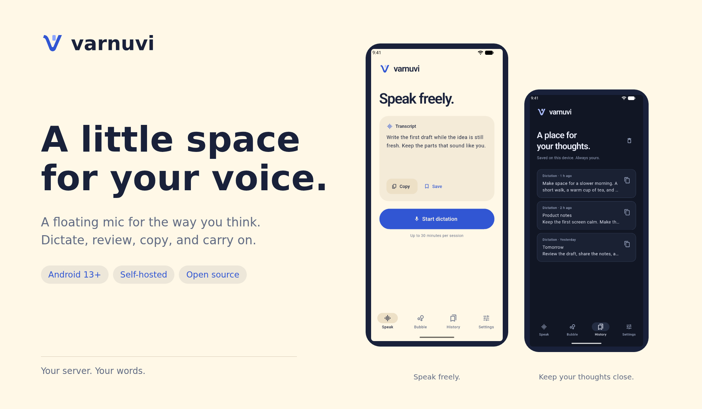
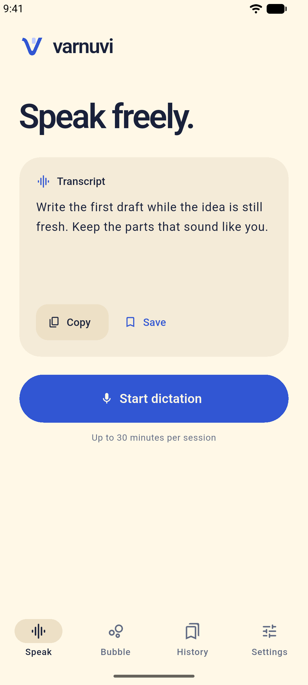
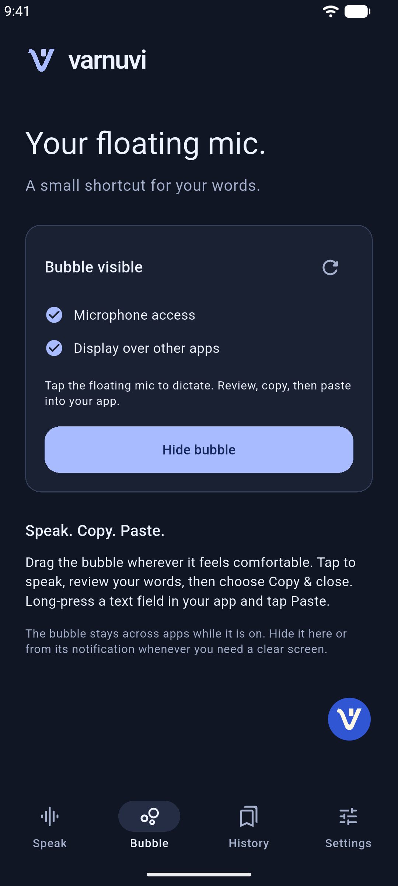
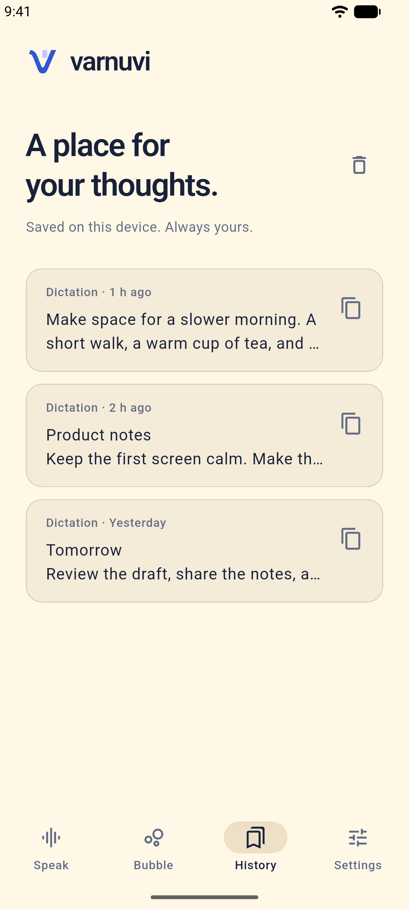
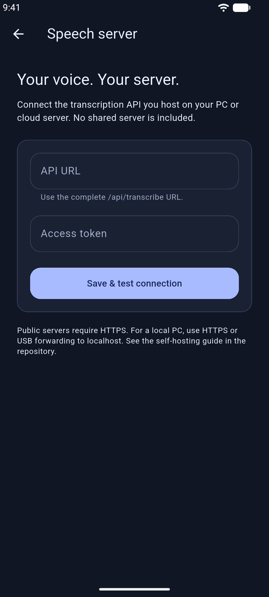

<p align="center">
  
</p>

<p align="center">
  <a href="https://github.com/shahdivax/varnuvi/releases"><strong>Download for Android</strong></a>
  &nbsp; · &nbsp;
  <a href="docs/SELF_HOSTING.md"><strong>Host your speech server</strong></a>
  &nbsp; · &nbsp;
  <a href="docs/DEVELOPMENT.md">Build from source</a>
</p>

<p align="center">Android 13+ &nbsp; · &nbsp; Self-hosted transcription &nbsp; · &nbsp; MIT licensed</p>

# Varnuvi

A small Android dictation app that gives your words room to land. Tap the floating
mic, speak naturally, review your text, then copy and paste it into your app.

**Your speech server, your choice.** Run the included faster-whisper API on a
personal PC or EC2. No transcription address, access token, or hosted service is
bundled. Optional AI writing uses your own OpenRouter connection.

## A quieter way to write

| Speak without stopping | Make it your own | Keep it close |
| --- | --- | --- |
| Record in the app or from a draggable floating mic. Continuous 30-second uploads support sessions up to 30 minutes. | Review and edit before copying. Add translation, summaries, tone, or formatting with optional AI writing. | Keep the latest 100 saved transcripts on your device. Choose light, dark, or system appearance. |

The bubble uses **Display over other apps**. There is no accessibility service,
screen reading, app tracking, or automatic insertion. You decide when to show it,
when to copy, and where to paste.

## Inside the app

<table>
  <tr>
    <td align="center" width="25%"><strong>Speak</strong><br /><br /><a href="docs/images/speak-light.png"></a><br /><sub>Room for a first draft.</sub></td>
    <td align="center" width="25%"><strong>Bubble</strong><br /><br /><a href="docs/images/bubble-dark.png"></a><br /><sub>A shortcut when you need it.</sub></td>
    <td align="center" width="25%"><strong>History</strong><br /><br /><a href="docs/images/history-light.png"></a><br /><sub>Thoughts worth returning to.</sub></td>
    <td align="center" width="25%"><strong>Your server</strong><br /><br /><a href="docs/images/server-dark.png"></a><br /><sub>Connect on your terms.</sub></td>
  </tr>
</table>

<sub>Actual app screens with synthetic example text. Tap a screen for the full-size image.</sub>

## Get started

1. Download the APK for your device from [Releases](https://github.com/shahdivax/varnuvi/releases).
   Most recent Android phones use **arm64-v8a**. Android 13 or newer is required.
2. [Run your speech server](docs/SELF_HOSTING.md) on a personal PC or EC2.
3. Open **Settings → Speech server**. Enter its complete API URL and access
   token, then choose **Save & test connection**.
4. Allow microphone access and start dictation from **Speak**.
5. For the floating shortcut, open **Bubble**, allow **Display over other apps**,
   then tap **Show bubble**. Notifications provide a quick Hide action.
6. Finish recording, review or edit your words, and select **Copy & close**.
   Long-press a text field in your destination app and choose **Paste**.

Example URL (placeholder only): `https://x.xx.xxx/api/transcribe`.
Replace it with your server's real HTTPS address. Nothing is preconfigured.

The bubble stays across apps while enabled. Hide it from the Bubble tab or its
notification. It hides while recording and on the lock screen. Some banking
apps restrict overlays or USB debugging; compatibility varies by device/app.

## One small API. Hosted by you.

You need only the included **`POST /api/transcribe`** endpoint. **`GET /health`**
is used to test the connection. No streaming API, timestamps API, OpenRouter key,
AWS credentials, or additional AI service is needed for transcription.

Start with [the self-hosting guide](docs/SELF_HOSTING.md):

| Setup | Guide |
| --- | --- |
| Personal PC, CPU | [Python setup](docs/SELF_HOSTING.md#personal-pc) |
| Phone over USB | [Local development](docs/SELF_HOSTING.md#connect-over-usb) |
| Personal PC over Wi-Fi/internet | [Private HTTPS connection](docs/SELF_HOSTING.md#connect-over-https) |
| EC2 with a domain and HTTPS | [EC2 deployment](docs/SELF_HOSTING.md#ec2) |
| Existing compatible backend | [API contract](docs/SELF_HOSTING.md#api-contract) |

## Optional AI writing

In **Settings → AI**, supply your own OpenRouter API key, choose a model, and
run the connection test. After it succeeds, you can turn **Use AI** on.

AI is off by default. With it off, transcripts never go to OpenRouter. With it
on, the completed transcript and writing preferences go to the selected model.
The connection test uses synthetic text and may consume provider credits.
Changing the key or model requires testing again.

## Privacy, by choice

- Audio goes to the speech server you configure, in WAV chunks.
- Public server connections require HTTPS and an access token. HTTP is allowed
  only for localhost/USB forwarding and the Android emulator.
- The included backend requires authentication, validates uploads, and removes
  temporary audio after each request. It does not call a remote AI API.
- Transcripts go to OpenRouter only when you enable AI writing.
- History stays on your device. Tokens use Android Keystore encryption.
- No analytics, ads, account system, cloud history sync, or Android backups.

Your server, reverse proxy, hosting provider, and optional model provider have
separate trust and retention boundaries. See [Privacy](PRIVACY.md) and
[Security](SECURITY.md). This project has not had an independent security audit.

## Build and test

Use Flutter/Dart, JDK 21, and the Android SDK. The app has no third-party runtime
Dart dependencies.

```sh
flutter pub get
flutter analyze
flutter test
flutter build apk --debug
python3 scripts/check_chunking.py
python3 scripts/check_accessibility.py
python3 scripts/check_public_source.py
```

For signed APKs, copy `android/key.properties.example` to the ignored
`android/key.properties` and supply your own keystore. Then build:

```sh
flutter build apk --release --split-per-abi
```

Signing keys, server configuration, tokens, audio, and build outputs must never
be committed. Release builds without signing properties remain unsigned.
See [Development](docs/DEVELOPMENT.md) and [Releasing](docs/RELEASING.md).

## Limits

Varnuvi needs a reachable server for transcription. It does not run a speech
model on the phone. Slow CPUs or a cold model may exceed the request timeout;
failed chunks can be retried while the session remains open. Recording stops
when the recording screen is left. Interrupted sessions are not restored after
Android kills the process. Normal cleanup removes audio, but process crashes
can leave cached files until app storage/cache is cleared.

## Project

[Architecture](docs/ARCHITECTURE.md) · [Self-hosting](docs/SELF_HOSTING.md) ·
[Contributing](CONTRIBUTING.md) · [Changelog](CHANGELOG.md) · [MIT license](LICENSE)
